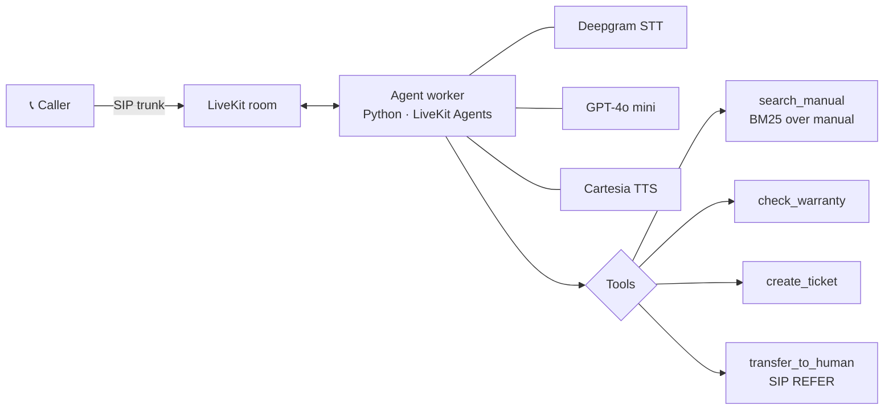

# LiveKit Voice Support Agent: Smart Thermostat

A phone support agent built on **LiveKit Agents** (Python). It troubleshoots a product step by step using **answers grounded in the product manual**, checks warranty and refund eligibility, opens support tickets, and **transfers to a human** over SIP when it should.

> Fictional product ("AeroFlow T2 smart thermostat"). Replace `manual/aeroflow-t2.md` with any product's documentation.

## Why LiveKit (vs. a hosted platform like Vapi)

- **You own the pipeline:** choose and swap STT, LLM and TTS providers, self-host if needed, and keep per-minute costs low at volume.
- **Telephony via SIP:** inbound and outbound calls, plus warm or cold transfer to a human queue.
- **Production audio:** Silero VAD, a semantic turn-detection model (fewer awkward interruptions), and telephony noise cancellation.

## What it does

| Caller says | Agent does |
|---|---|
| "My thermostat won't connect to Wi-Fi" | Looks up the manual, explains the 2.4 GHz requirement, walks through setup one step at a time |
| "The screen says E3" | Finds the exact error code and troubleshoots the furnace switch, breaker and wiring, with a power-off safety reminder first |
| "Can I still return it?" | Asks for the serial and purchase date, checks the 30-day return and 2-year warranty windows |
| "Does it work with Alexa?" | The manual doesn't say, so it **does not guess**. It offers a ticket or a human |
| "It's still not working" | Opens a ticket with name, callback number and what was tried, and reads back the ticket ID |
| "Let me talk to a person" | Transfers the SIP call during support hours; otherwise offers a call-back ticket |

## Architecture



- **`agent.py`**: the LiveKit agent: instructions, four function tools, audio pipeline.
- **`support_agent/retrieval.py`**: dependency-free BM25 retrieval over the manual's sections, with synonyms ("wifi" → "wi-fi", "reboot" → "restart") and exact error-code boosting. Sub-millisecond lookups, no embedding API.
- **`support_agent/desk.py`**: warranty math, ticket creation, support-hours routing. Pure Python and fully unit-tested.

## Design decisions

- **Grounded or silent:** retrieval returns `NOT_IN_MANUAL` below a calibrated score, and the prompt forbids guessing. Off-topic questions ("garage door", "Alexa", "price") are covered by tests.
- **Voice-first troubleshooting:** one step at a time, confirm, continue. Always a power-off reminder before wiring.
- **Escalation that respects reality:** transfers only during staffed hours and only for phone callers; otherwise a ticket with a readable ID.
- **Swap-friendly retrieval:** BM25 is ideal for one manual. For hundreds of documents, swap `ManualIndex` for a vector store; the tool interface stays the same.

## Run it

```bash
python3 -m unittest discover -s tests -t .     # 10 tests: retrieval, grounding, warranty, tickets, hours
python3 scripts/ask.py "the light is blinking amber"   # try the knowledge lookup offline
```

Talk to the agent (needs API keys):

```bash
python3 -m venv .venv && source .venv/bin/activate
pip install -r requirements.txt
cp .env.example .env        # LiveKit, OpenAI, Deepgram, Cartesia keys
python agent.py download-files
python agent.py console     # speak to it from your terminal
python agent.py dev         # connect to LiveKit Cloud; call via a SIP number or the Agents Playground
```

## Running cost (approximate, per minute)

| Component | ~USD / min |
|---|---|
| LiveKit Cloud (agent session + SIP) | 0.01–0.02 |
| Deepgram Nova-3 STT | 0.005–0.008 |
| GPT-4o mini | < 0.01 |
| Cartesia TTS | 0.02–0.04 |
| Telephony (SIP trunk) | 0.005–0.01 |
| **Total** | **≈ 0.05–0.08** |

Self-hosting LiveKit and the models lowers this further at scale. Check current provider pricing before quoting.

---

Built by **[Codewright](https://github.com/codewright-dev)**: production voice AI agents (LiveKit, Vapi, Twilio), GenAI and backend systems.
